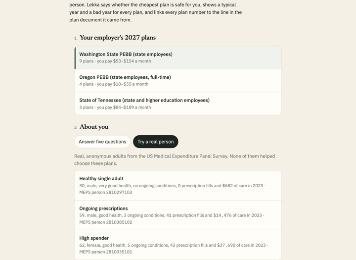
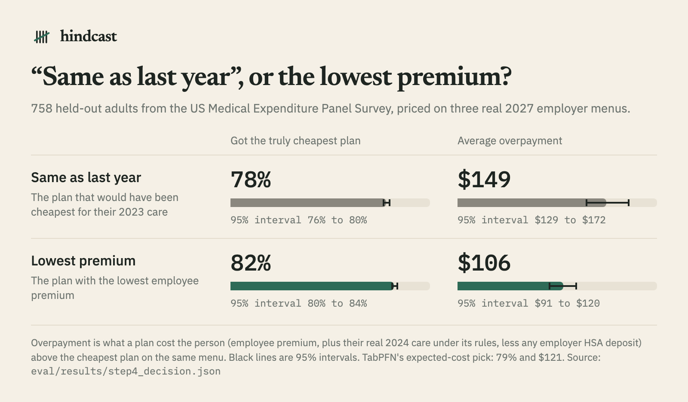

# Hindcast

*Check your 2027 plan against what really happened.*

Hindcast tells you whether the cheapest 2027 health plan on your employer's menu is safe for you.

- **When it is,** Hindcast says so, and shows a typical year and a bad year (1 in 10) for every plan.
- **When your costs are hard to predict,** it tells you to look closer instead of pretending to know the winner.
- **Every plan number** links to the line in the plan document it came from, highlighted, with the page number.

A hindcast is a forecast tested on the past. Every plan here is priced on real survey people's 2024 care, and the advice was tested against what actually happened to 758 held-out people in 2024.

Built with PriorLabs-TabPFN. Plan documents are read by Gemma 4 running on your own computer.



## Results

Each evaluation was frozen before scoring, and each test set was scored once. Every number below links to the JSON file it comes from. [eval/NUMBERS.md](eval/NUMBERS.md) gives the exact key for each number and the command that produces it, and `make numbers` fails if this table drifts from the JSON.



| Question | Answer |
|---|---|
| How often does each choice give the truly cheapest plan? ([758](eval/results/step4_decision.json) held-out adults, three real 2027 menus) | Lowest premium [82%](eval/results/step4_decision.json). "Same as last year" [78%](eval/results/step4_decision.json). TabPFN's expected-cost pick [79%](eval/results/step4_decision.json). |
| Average overpayment against the cheapest plan | Lowest premium [$106](eval/results/step4_decision.json). Same as last year [$149](eval/results/step4_decision.json). TabPFN [$121](eval/results/step4_decision.json). Paired against TabPFN: lowest premium [-$15](eval/results/step4_decision.json), same as last year [+$28](eval/results/step4_decision.json). |
| Does the plan reader get the numbers right? ([260](eval/results/step3_reader.json) key values on [20](eval/results/step3_reader.json) held-out plan documents) | `gemma4:e4b-it-qat`: [91.9%](eval/results/step3_reader.json) right, [3.5%](eval/results/step3_reader.json) wrong, [4.6%](eval/results/step3_reader.json) flagged "check this". The smaller e2b build: [88.1%](eval/results/step3_reader.json). The larger 26b-a4b build: [89.2%](eval/results/step3_reader.json). |
| Can it spot people for whom the lowest premium costs over $250 extra? (They are [11%](eval/results/step4b_lazy_safe.json) of cases.) | A TabPFN classifier separates them with AUC [0.756](eval/results/step4b_lazy_safe.json) and finds [50%](eval/results/step4b_lazy_safe.json) of them. |
| Does "lowest premium unless flagged" beat always taking the lowest premium? | No. It averages [$119](eval/results/step4b_lazy_safe.json) against $106 (paired [+$13](eval/results/step4b_lazy_safe.json)). Perfect flags would reach [$97](eval/results/step4b_lazy_safe.json). So "look closer" names no plan. |
| How much data does the spend model need? | TabPFN gets within 5% of its full-data loss with [200](eval/results/step2b_learning_curve.json) training people, at the median and the 90th percentile. Gradient boosting needs [200](eval/results/step2b_learning_curve.json) and [400](eval/results/step2b_learning_curve.json). Linear quantile regression needs [800](eval/results/step2b_learning_curve.json) and all [2,275](eval/results/step2b_learning_curve.json). |
| How well does it predict next year's spending? | TabPFN's median pinball loss is [$3,496](eval/results/step2_spend.json) per person, against [$4,682](eval/results/step2_spend.json) for "same as last year". Paired, it beats same as last year by [+$1,185](eval/results/step2_spend.json) and age-sex medians by [+$461](eval/results/step2_spend.json). [77%](eval/results/step2_spend.json) of actual 2024 spending fell inside its 10–90% band (the target is 80%). |

**What this means for the design.** On these menus the lowest premium is a strong default: it beat TabPFN's own expected-cost pick. So Hindcast starts from the lowest premium. It uses TabPFN to show what a typical and a bad year could cost, and to say when a person should look closer.

More charts: [plan choice](docs/media/chart-2-plan-choice.png), [learning curve](docs/media/chart-3-learning-curve.png), [plan reader](docs/media/chart-4-plan-reader.png).

## How it works
- **Reading plans.** `gemma4:e4b-it-qat` runs locally through Ollama.
  - It only quotes. It returns each field as `{quote, page}`, and code checks that the quote is in the PDF's text before parsing the number from it.
  - A field without a verified quote is shown as "check this", never guessed.
- **Predicting next year's care.** TabPFN v2 is trained on MEPS Panel 28: the same adults in 2023 and 2024.
- **Pricing plans.** Each plan is priced on the real 2024 care of the 5 survey people whose actual spending was nearest your predicted median (typical year) or 90th percentile (bad year).
- **Deciding.** The rules engine (`sameaslastyear/costs.py`) handles deductibles, copays, coinsurance, out-of-pocket limits and HSA deposits. It reproduces a real plan's printed coverage examples to the dollar.
- **The "look closer" check.** A TabPFN classifier flags people for whom the lowest premium is likely to cost more than $250 extra.

## Run it
Requires [uv](https://docs.astral.sh/uv/) and [Ollama](https://ollama.com) 0.40 or later.

```bash
make setup   # Python 3.12 env from uv.lock, plus the three Gemma 4 QAT builds (about 25 GB)
make data    # MEPS files to parquet, plan documents and rate sheets, with manifests
make eval    # every evaluation, then eval/NUMBERS.md
make app     # local mode at http://127.0.0.1:8765
make test    # unit tests
```

- **Static site (`docs/`).** No backend. Pick one of three real 2027 menus (Washington PEBB, Oregon PEBB, Tennessee state employees). Then answer five questions, or pick one of three real, anonymous people from the US Medical Expenditure Panel Survey. Nothing you choose leaves your browser. To view it locally:

  ```bash
  python3 -m http.server 8766 --bind 127.0.0.1 --directory docs
  ```

  All its URLs are relative, so it also works from a subpath such as GitHub Pages. `make pages-check` serves it from `/hindcast/` and fails on any missing file, console error or outside request.
- **Local mode (`make app`).** The same UI, but your five answers are worked out live on this computer's CPU. You can also upload a plan's Summary of Benefits and Coverage PDF, and it is read on this computer. Nothing is sent anywhere: the server listens on 127.0.0.1 only, the fonts are self-hosted, and the PDF reader talks to a local Ollama server. It fits TabPFN on the survey's training people, so run `make data` and `make eval-spend` first.

Other targets: `check` (TabPFN and Gemma smoke tests), `split-hash`, `eval-spend`, `eval-reader`, `eval-decision`, `eval-lazy`, `numbers`, `app-data`, `capture` (screenshots), `media` (post charts).

## What it can't do
- **Only three menus, and self-only coverage.** It prices the three 2027 menus in `docs/data`, and only self-only coverage. Family coverage is in the rules engine and its tests, but not in the benchmark or the app.
- **Plans you upload are read, not priced.** A Summary of Benefits and Coverage has no premium, so in local mode Hindcast shows what it read, with quotes and "check this" flags.
- **"Look closer" names no plan.** In testing, picking a plan for flagged people did worse than taking the lowest premium. The check finds about half of the people for whom the lowest premium costs more than $250 extra.
- **The care model is approximate.** Each visit takes one cost-sharing row on its full payment. Prescriptions are split into generic and brand at $50 a fill, because the survey does not say which is which. Dental, vision, home health and other spending are left out; together these are about 12% of 2024 spending. The full list is in "How sure is this?" and in `eval/results/step4_decision.json`.
- **Typical and bad years rest on 5 survey people each.** Small changes in the prediction (for example, local mode's CPU arithmetic against the precomputed grid) can swap which people are used, and move a plan's estimate by a few hundred dollars.
- **Regional plans are treated as available to everyone.** Some plans (for example Kaiser Permanente NW) are regional.
- **The reader is weakest on unusual tables.** It struggles with Tennessee's tier tables, cells with two in-network rates, and typos in the source PDF (one plan prints its deductible as "$1.800"). Such values are flagged or shown with a "check this" note.
- **TabPFN v2, not v3.5.** The newer v3.5 model needs a Prior Labs license acceptance that has not been given.
- **Gold labels are unchecked.** The evaluation's gold values were transcribed by Claude and have not been checked by a person.
- **Costs are estimates.** They are not quotes from your employer or a plan.

## Data
- `data/meps_manifest.csv`: the MEPS files with source URL, retrieval time, SHA-256 and row counts. The parquet files stay local in `data/raw/`.
- `data/sbc/manifest.csv`: 45 public Summary of Benefits and Coverage PDFs from 11 sponsors, plus 18 rate sheets and plan documents.
- `data/menus/menus_2027.json`: the three 2027 menus. Every value is quote-verified when loaded.
- `eval/split.json`: the frozen held-out set of 20 plan documents.
- `eval/spend_split.json`: the frozen person split (2,275 train, 758 test).
- `eval/gold/heldout_gold.json`: gold values for the held-out plan documents. Claude transcribed them, not a person; the method and caveats are in `eval/README.md`.

`BRIEF.md` is the spec, `DECISIONS.md` records every choice and why, and `RESUME.md` logs each build step.

## Credits and licenses
The code and the text written for this project are under the [MIT license](LICENSE). The data, documents, models and fonts below belong to others and keep their own terms.

- **Medical Expenditure Panel Survey (MEPS).** Public-use files from the Agency for Healthcare Research and Quality (AHRQ): HC-257 (Panel 28, 2023–2024), HC-256 (2024 full-year consolidated), HC-254A/D/E/F/G (2024 events) and HC-248A/D/E/F/G (2023 events). Source: Agency for Healthcare Research and Quality, Medical Expenditure Panel Survey. The raw files are not redistributed here; `make data` downloads them, and `data/meps_manifest.csv` records each source URL and hash. The repo holds only derived data: the person split, aggregate results, and the site's three example people and price grid. AHRQ's data use agreement allows statistical reporting and analysis only, and forbids any attempt to identify a person. Hindcast makes no such attempt.
- **Plan documents.** Public 2027 plan documents (Summaries of Benefits and Coverage, rate sheets and plan guides) published by Washington State PEBB (Health Care Authority), Oregon PEBB, the State of Tennessee (Partners for Health), CalPERS, the City of Albuquerque, the Georgia State Health Benefit Plan, the New Jersey State Health Benefits Program, the State of Colorado, the State of Delaware, the University of California and the University of Texas System. They are copied unchanged into `data/sbc/` so that every quote can be checked. `data/sbc/manifest.csv` lists each file's source URL, retrieval time and SHA-256. Their content belongs to their publishers.
- **TabPFN.** Spend predictions and the "look closer" check use TabPFN v2 from Prior Labs, through the `tabpfn` Python package (Apache-2.0). The v2 model weights are licensed under the Prior Labs License 1.1; a copy is in [licenses/PriorLabs-License-1.1.txt](licenses/PriorLabs-License-1.1.txt). Built with PriorLabs-TabPFN. Paper: Hollmann et al., "Accurate predictions on small data with a tabular foundation model", *Nature* 637, 319–326 (2025).
- **Gemma 4.** The plan reader uses Google's Gemma 4 QAT builds (`gemma4:e2b-it-qat`, `gemma4:e4b-it-qat`, `gemma4:26b-a4b-it-qat`) through Ollama. Their Ollama builds ship under the Apache License 2.0 (`ollama show <model> --license`). No weights are redistributed here.
- **Fonts.** Newsreader (The Newsreader Project Authors) and IBM Plex Sans and Mono (IBM), self-hosted from Google Fonts under the SIL Open Font License 1.1. The license texts are in `docs/fonts/`.
- **2027 limits** in `sameaslastyear/costs.py` cite their public sources inline: IRS Rev. Proc. 2026-24 and CMS's 2027 payment notice guidance.
